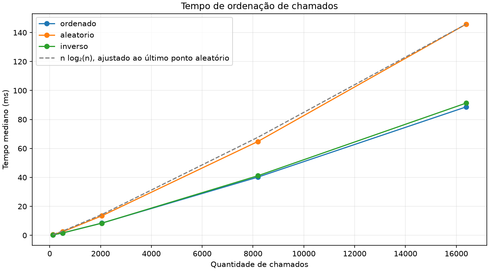
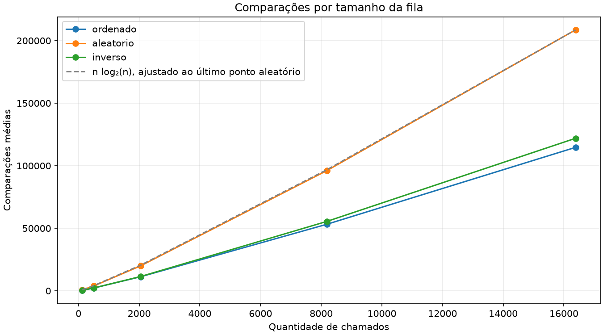
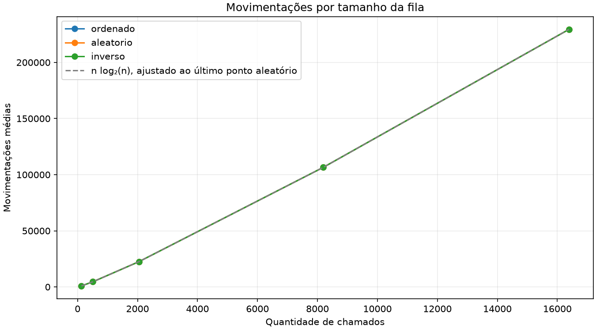

# G36_Ordenacao_EDA2 - FilaChamados

Sistema de linha de comando (CLI) em Python para uma fila de chamados de suporte técnico,
ordenada por prioridade e horário de chegada com o algoritmo Merge Sort.

O objetivo do trabalho é aplicar os algoritmos de ordenação estudados em EDA2,
implementando o Merge Sort e analisando sua complexidade, sua estabilidade e seu
desempenho conforme a quantidade de chamados cresce.

## Estado do projeto

Implementados: Merge Sort estável com contadores, gestão de chamados e CSV,
CLI, visualização passo a passo, análise dos casos, benchmark com gráficos e
apresentação em vídeo.

## Vídeo de apresentação

https://drive.google.com/file/d/1gv6Q2ngZiVevqXgxdwwyXdDUO1VtXvt6/view?usp=sharing

## Alunos

| Matrícula | Nome                           |
| --------- | ------------------------------ |
| 231011328 | Felipe de Aquino Campelo       |
| 232000688 | Arthur Palhares Ferreira Silva |

## Descrição

O sistema gerencia chamados de atendimento (cliente, descrição, prioridade e horário de
chegada). A prioridade vai de 1 (crítica) a 4 (baixa) e o horário é informado no formato
HH:MM. A fila é sempre apresentada ordenada por prioridade e, em caso de empate, pelo
horário de chegada, de forma que o próximo chamado a ser atendido é o primeiro da fila.

É possível registrar chamados, ver a fila ordenada, atender o próximo e acompanhar o
Merge Sort passo a passo. Os dados são persistidos em arquivo CSV.

## Algoritmo de ordenação

- Merge Sort: algoritmo de divisão e conquista que divide a lista ao meio, ordena cada
  metade recursivamente e intercala as duas metades já ordenadas.
- Estável: chamados com a mesma prioridade e o mesmo horário mantêm a ordem em que foram
  registrados, o que é essencial para uma fila justa.
- Complexidade: Θ(n log n) em tempo no melhor, médio e pior caso; O(n) de espaço auxiliar.
- Cada ordenação informa o número de comparações e de movimentações realizadas.

## Como executar

Requisitos: Python 3.11+.

```bash
python -m venv .venv
source .venv/bin/activate
python -m pip install -r requirements.txt
python main.py
```

No menu, use as opções 1 a 4 para registrar, listar, atender e visualizar o
Merge Sort. A opção 0 salva e sai; Ctrl+C encerra sem salvar. O passo a passo
aceita até 16 chamados. Para escolher outro CSV: `python main.py --dados fila.csv`.

Exemplo de uso por código, a partir da pasta do projeto:

```bash
python - <<'PY'
from atendimento import FilaAtendimento

fila = FilaAtendimento()
fila.carregar_csv("chamados.csv")
fila.registrar("Fernanda", "Sistema indisponível", 1, "08:50")
chamados, estatisticas = fila.listar_ordenados()
for chamado in chamados:
    print(chamado)
print(estatisticas)
atendido, estatisticas = fila.atender_proximo()
print("Atendido:", atendido)
print("Operações do atendimento:", estatisticas)
fila.salvar_csv("/tmp/filachamados-exemplo.csv")
PY
```

Os horários devem estar em `HH:MM` e são considerados dentro de um mesmo dia.
Prioridades aceitas: inteiros de 1 a 4. Cliente e descrição não podem ser vazios.
O CSV usa UTF-8 e cabeçalho `cliente,descricao,prioridade,horario`; preserva a
ordem de registro para desempates. Carregar substitui a fila apenas após validar
todo o arquivo. Arquivo ausente gera `FileNotFoundError`; formato inválido gera
`ValueError`. Registrar e atender só alteram a memória: use `salvar_csv` para persistir.

`merge_sort` e `listar_ordenados` retornam `(lista, estatisticas)`;
`atender_proximo` retorna `(chamado, estatisticas)`, com `None` na fila vazia.
As comparações contam avaliações de chaves entre metades; as movimentações contam
cada inserção no resultado das intercalações, incluindo sobras. Cópias de fatias
não entram nessa contagem. Os contadores reiniciam a cada ordenação.

Testes automatizados:

```bash
python -m pytest
```

Análise dos casos e experimento de desempenho:

```bash
python casos.py
python benchmark.py
```

## Análise e metodologia do benchmark

`casos.py` usa chaves inteiras distintas e tamanhos potência de dois. Para esses
valores, as comparações são `(n/2) log₂(n)` no melhor caso e
`n log₂(n) - n + 1` no pior. O cenário médio estima as comparações por meio de
30 permutações aleatórias por tamanho, com semente 7. As movimentações são
`n log₂(n)` nesses tamanhos. Todos os casos têm tempo Θ(n log n).
Uma lista invertida não é necessariamente o pior caso do Merge Sort.

`benchmark.py` mede o algoritmo aplicado a objetos `Chamado`, usando a mesma
chave `(prioridade, horario)` da aplicação. Por padrão:

- Tamanhos: 128, 512, 2.048, 8.192 e 16.384 chamados.
- Cinco amostras independentes por tamanho, com semente 36.
- Três repetições por amostra e cenário: 225 medições no total.
- Cenários ordenado, aleatório e inverso derivados dos mesmos chamados por amostra.
- Prioridades entre 1 e 4 e horários entre 00:00 e 23:59, com possíveis empates.
- Aquecimento por amostra e cenário, seguido de medições com `perf_counter_ns`.
  A ordem dos cenários varia entre repetições para reduzir efeitos da ordem de execução.

O cronômetro inclui apenas a chamada de `merge_sort`, com chave e contadores,
sem trace. Geração dos dados, verificação de correção/estabilidade, CSVs e gráficos
ficam fora da medição. A função nativa `sorted` é usada como referência de
correção e para preparar cenários, não como implementação do algoritmo medido.

Para personalizar:

```bash
python benchmark.py --tamanhos 256 1024 4096 --amostras 10 --repeticoes 5 --semente 36 --saida resultados/alternativo
```

Os arquivos gerados na pasta de saída são substituídos a cada execução:

| Arquivo | Conteúdo |
| ------- | -------- |
| `medicoes.csv` | Tempo e contadores de cada amostra/repetição |
| `resumo.csv` | Média, mediana e desvio padrão amostral dos tempos; médias dos contadores |
| `ambiente.json` | Versões, plataforma e parâmetros para reprodução |
| `tempos.png` | Tempo mediano por tamanho e cenário |
| `comparacoes.png` | Média de comparações por tamanho e cenário |
| `movimentacoes.png` | Média de movimentações por tamanho e cenário |

Os gráficos incluem uma curva `n log₂(n)` ajustada ao último ponto aleatório,
apenas como referência visual de crescimento. As repetições da mesma amostra
medem variação de tempo; não são novas entradas independentes. A semente reproduz
as entradas e os contadores, mas os tempos dependem da máquina e de sua carga.
Os cenários do benchmark não são limites teóricos de melhor/pior caso, pois há
chaves repetidas. A demonstração dos limites fica em `casos.py`.

### Resultados da execução incluída

Com 16.384 chamados, as medianas foram 88,659 ms para a fila ordenada,
145,799 ms para a aleatória e 91,286 ms para a inversa. Na fila aleatória,
dobrar de 8.192 para 16.384 chamados elevou o tempo de 64,801 para 145,799 ms
(aproximadamente 2,25 vezes). Os resultados são compatíveis com o crescimento
n log₂(n), mas tempos experimentais não constituem uma prova de complexidade.

Nesse maior tamanho, as comparações médias foram 114.688, 208.603,6 e 121.945,4,
respectivamente. As movimentações foram 229.376 nos três cenários: sua contagem
depende das intercalações, não da ordem inicial. Por isso, as curvas de
movimentações se sobrepõem. Os números descrevem a execução incluída nos CSVs;
uma nova execução pode produzir tempos diferentes.







O espaço auxiliar do algoritmo sem trace é O(n). A visualização guarda cópias de
cada etapa e pode usar O(n log n) de memória; por isso, fica desativada no benchmark.

## Estrutura do projeto

```
main.py            CLI com menu interativo
merge_sort.py      Merge Sort com contadores de comparações e movimentações
atendimento.py     chamado, validações, fila de atendimento e CSV
casos.py           melhor, médio e pior caso do Merge Sort
benchmark.py       experimento de desempenho e gráficos
chamados.csv       base de exemplo
test_*.py          testes automatizados
resultados/        medições, resumo, ambiente e gráficos do benchmark
```
